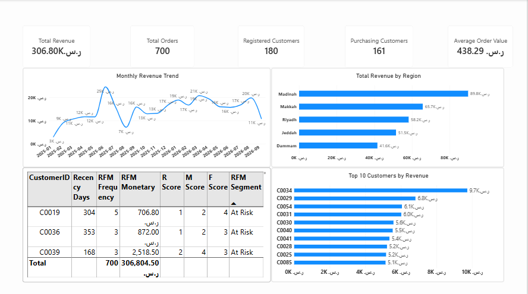
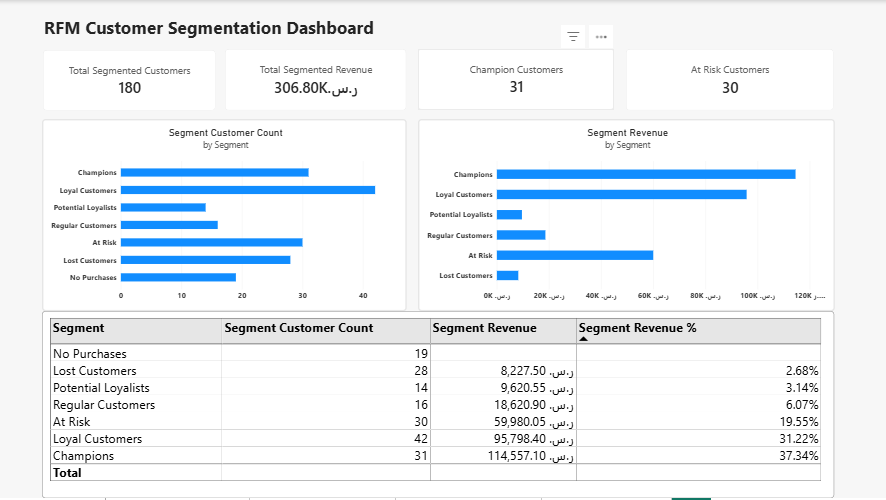
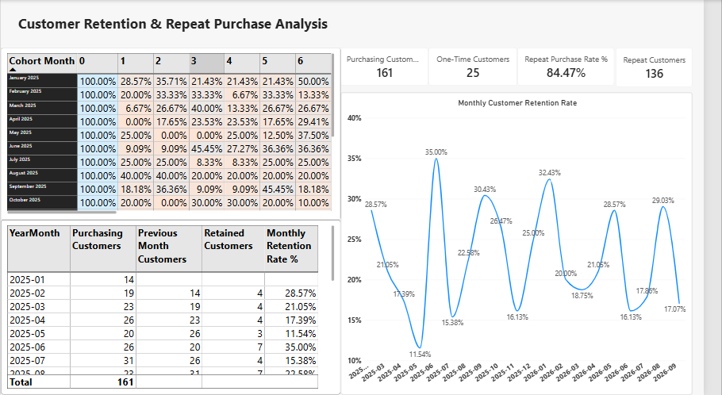
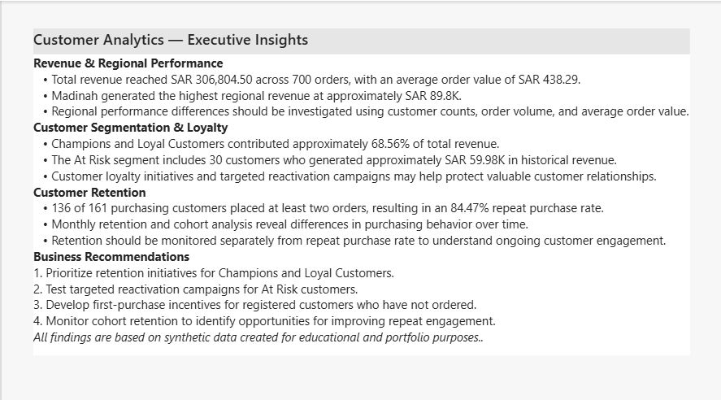

# Customer Behavior & RFM Analysis | Power BI

An interactive **Power BI portfolio project** exploring customer purchasing behavior, revenue performance, RFM-based segmentation, repeat purchases, monthly retention, and cohort retention. The goal is to translate customer transaction data into actionable business insights.

> **Dataset notice:** All data is synthetic and used for educational and portfolio demonstration purposes. The findings do not represent a real company's performance.

## Dashboard Preview


### 1. Customer Overview



Summarizes revenue, orders, registered and purchasing customers, average order value, monthly revenue trends, regional revenue, and the top 10 customers by revenue. Includes customer-level RFM details.

### 2. RFM Segmentation



Groups customers using **Recency**, **Frequency**, and **Monetary** scores. Compares customer counts, revenue, and revenue contribution across segments such as Champions, Loyal Customers, At Risk, and No Purchases.

### 3. Customer Retention



Examines repeat purchase behavior, month-over-month customer retention, and cohort retention. The cohort matrix distinguishes **0% retention in an observed month** from **blank values for future, unobserved months**.

### 4. Business Insights



Presents an executive summary of the results and practical recommendations for customer loyalty, reactivation, regional analysis, and retention monitoring.

## Project Objectives

- Monitor sales and customer activity using business KPIs.
- Understand purchasing patterns and identify high-value customers.
- Segment customers using the RFM framework.
- Compare revenue contributions across customer segments and regions.
- Measure repeat purchasing and monthly customer retention.
- Analyze retention by first-purchase cohort.
- Translate findings into practical business recommendations.

## Tools & Skills

- **Power BI Desktop:** Interactive dashboards, KPI cards, charts, and matrices
- **Power Query:** Data inspection, data types, and preparation
- **DAX:** Revenue, customer, RFM, and retention calculations
- **Data Modeling:** Relationships between customer, order, product, and date data
- **Customer Analytics:** RFM segmentation, repeat purchase, retention, and cohort analysis
- **Business Intelligence:** Data storytelling and decision-oriented recommendations

## Dataset & Model

The synthetic dataset contains **180 registered customers** and **700 orders**, with customer, order, and product data. The analysis covers transactions shown in the dashboard from **January 2025 through September 2026**.

Main source files:

- `customers.csv` — customer attributes and registration details
- `orders.csv` — orders, dates, customer/product identifiers, and sales amounts
- `products.csv` — product reference information

A Date table supports time-based analysis. Customer-to-order and product-to-order relationships enable filtering across the model.

## RFM Methodology

**RFM** stands for:

- **Recency (R):** How recently a customer purchased relative to the analysis date; fewer days indicates more recent activity.
- **Frequency (F):** How often a customer placed orders.
- **Monetary (M):** How much revenue a customer generated.

The report assigns R, F, and M scores and maps customers into business-friendly segments, including **Champions**, **Loyal Customers**, **Potential Loyalists**, **Regular Customers**, **At Risk**, **Lost Customers**, and **No Purchases**.

## Retention Methodology

- **Repeat Purchase Rate:** Share of purchasing customers who placed more than one order during the observed period.
- **Monthly Retention Rate:** Share of customers active in the previous month who also purchased in the current month.
- **Cohort Retention:** Share of customers from the same first-purchase month who purchased again in a given month since their first purchase.

For cohort analysis, **Month 0 = 100%** for each observed cohort. Completed months without returning customers display **0%**; future months beyond the dataset's observation window remain blank.

## Key Results

*All figures below are from the unfiltered synthetic dataset; displayed chart values may be rounded.*

| KPI | Result |
|---|---:|
| Total Revenue | SAR 306,804.50 |
| Total Orders | 700 |
| Registered Customers | 180 |
| Purchasing Customers | 161 |
| Average Order Value | SAR 438.29 |
| Repeat Customers | 136 |
| One-Time Customers | 25 |
| Repeat Purchase Rate | 84.47% |

### Regional Revenue

- **Madinah:** approximately SAR 89.8K — highest revenue
- **Makkah:** approximately SAR 65.7K
- **Riyadh:** approximately SAR 58.2K
- **Jeddah:** approximately SAR 51.5K
- **Dammam:** approximately SAR 41.6K

### Customer Segmentation

| Segment | Customers | Revenue | Revenue Share |
|---|---:|---:|---:|
| Champions | 31 | SAR 114,557.10 | 37.34% |
| Loyal Customers | 42 | SAR 95,798.40 | 31.22% |
| At Risk | 30 | SAR 59,980.05 | 19.55% |
| Regular Customers | 16 | SAR 18,620.90 | 6.07% |
| Potential Loyalists | 14 | SAR 9,620.55 | 3.14% |
| Lost Customers | 28 | SAR 8,227.50 | 2.68% |
| No Purchases | 19 | SAR 0.00 | 0.00% |

**Champions and Loyal Customers** together account for **68.56% of revenue** and **73 customers**. The **At Risk** group contains 30 customers with approximately SAR 59.98K in historical revenue.

## Business Recommendations

1. **Protect high-value relationships:** Test loyalty benefits and personalized engagement for Champions and Loyal Customers.
2. **Re-engage At Risk customers:** Evaluate targeted campaigns for customers with meaningful historical spending but declining recency.
3. **Activate non-purchasers:** Test first-order incentives for the 19 registered customers with no recorded purchases.
4. **Investigate regional differences:** Compare revenue alongside customer counts, order frequency, and average order value before deciding where to invest.
5. **Monitor retention over time:** Use monthly retention and cohort analysis alongside repeat purchase rate, since these metrics answer different questions.

## Repository Structure

```text
Customer-Behavior-RFM-Analysis-PowerBI/
├── README.md
├── Customer_Behavior_RFM_Analysis.pbix
├── customers.csv
├── orders.csv
├── products.csv
├── 01_Customer_Overview.png
├── 02_RFM_Segmentation.png
├── 03_Customer_Retention.png
└── 04_Business_Insights.png
```

## How to Explore the Report

1. Download [Download Power BI Report](Customer_RFM_Analysis.pbix)
2. Open it using **Microsoft Power BI Desktop**.
3. Explore the **Customer Overview**, **RFM Segmentation**, **Customer Retention**, and **Business Insights** pages.
4. Use filters and chart interactions to examine specific customers, regions, segments, or periods.
5. Clear filters to return to the unfiltered KPIs documented above.

## Project Scope & Limitations

This is a **synthetic-data learning and portfolio project**, not a production deployment. The results demonstrate analytical methods and dashboard development, but should not be treated as evidence of real-world customer behavior or campaign effectiveness. Business recommendations are hypotheses to test, not verified causal outcomes.
